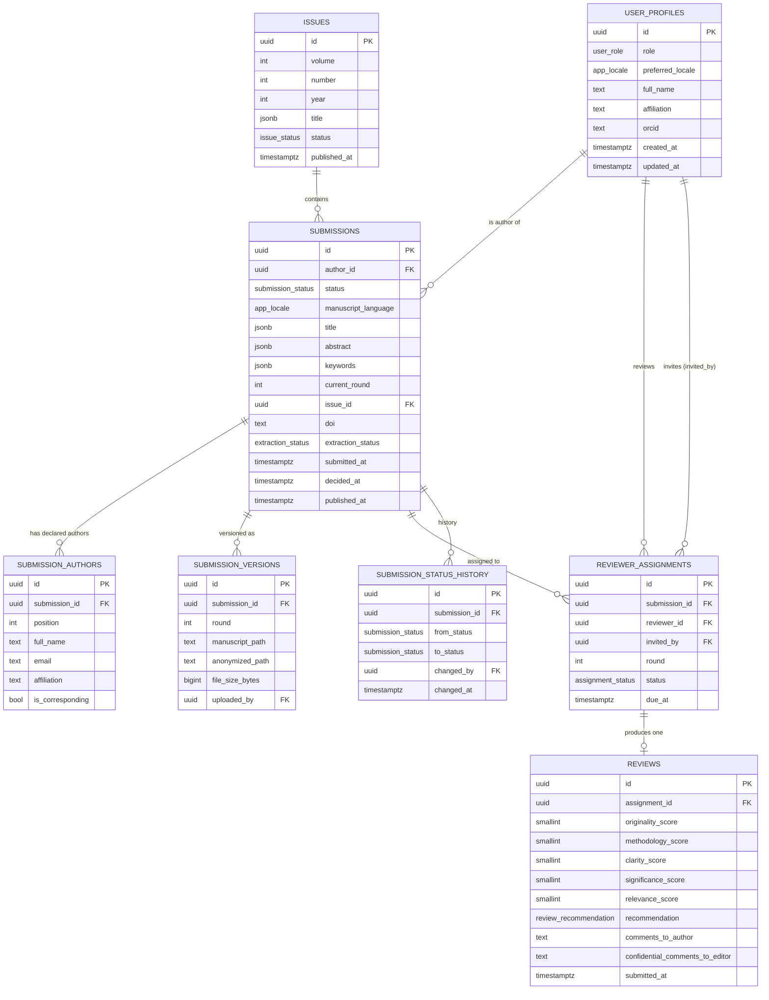
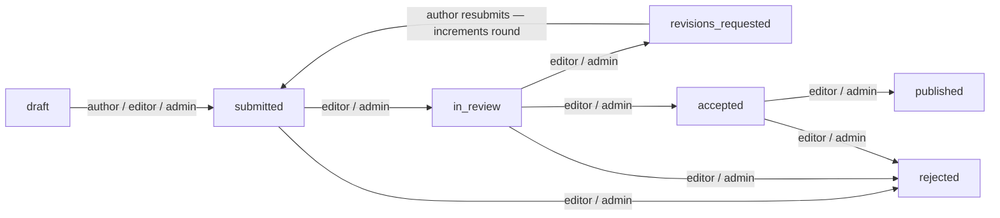

# Database Architecture — Journal Platform

## Entity-Relationship Diagram



---

## Enum Values

| Enum | Values |
|---|---|
| `user_role` | `author` · `reviewer` · `editor` · `admin` |
| `submission_status` | `draft` · `submitted` · `in_review` · `revisions_requested` · `accepted` · `rejected` · `published` |
| `review_recommendation` | `accept` · `minor_revisions` · `major_revisions` · `reject` |
| `assignment_status` | `invited` · `accepted` · `declined` · `completed` |
| `app_locale` | `en` · `fr` · `ar` |
| `issue_status` | `draft` · `published` |
| `extraction_status` | `not_started` · `pending` · `succeeded` · `failed` |

---

## Status Transition Graph



| From | To | Who | Side-effect |
|---|---|---|---|
| `draft` | `submitted` | author, editor, admin | — |
| `submitted` | `in_review` | editor, admin | — |
| `submitted` | `rejected` | editor, admin | — |
| `in_review` | `revisions_requested` | editor, admin | — |
| `in_review` | `accepted` | editor, admin | — |
| `in_review` | `rejected` | editor, admin | — |
| `revisions_requested` | `submitted` | **author**, editor, admin | `current_round += 1` |
| `accepted` | `published` | editor, admin | — |
| `accepted` | `rejected` | editor, admin | — |

> [!NOTE] When `auth.uid()` is `null` (service role / backend API), any valid transition in the table above is allowed without a caller-role check. This is the standard Supabase pattern for backend-initiated operations.

Every transition is recorded as an immutable row in `submission_status_history` by the `private.record_status_change()` SECURITY DEFINER trigger.

---

## i18n Column Convention

Three columns on `submissions` carry per-language content:

| Column | Type | Example |
|---|---|---|
| `title` | `jsonb` | `{"en": "Machine Learning in Medicine", "fr": "L'apprentissage automatique en médecine"}` |
| `abstract` | `jsonb` | `{"en": "...", "ar": "..."}` |
| `keywords` | `jsonb` | `{"en": ["ML", "health"], "ar": ["تعلم الآلة"]}` |

Rules enforced by CHECK constraints:
- Top-level keys must be a subset of `{en, fr, ar}` (validated by `private.valid_i18n_keys()`).
- When `status ≠ 'draft'`, the title in `manuscript_language` must be non-empty.

---

## Storage Path Conventions

| Bucket | Visibility | Path template | Who can write |
|---|---|---|---|
| `manuscripts` | **Private** | `{author_id}/{submission_id}/v{round}.pdf` | Author (own folder), service role |
| `manuscripts-anonymized` | **Private** | `{submission_id}/v{round}.pdf` | Service role only |
| `published` | **Public** | `{submission_id}/v{final}.pdf` | Editor, admin, service role |

Path components are compared as `text` in storage policies — folder components are never cast to `uuid` to prevent injection via crafted filenames.

---

## Permission Matrix

| Resource | `anon` | `author` | `reviewer` | `editor` | `admin` |
|---|---|---|---|---|---|
| `user_profiles` | — | SELECT own · UPDATE(4 cols) own | SELECT own · UPDATE(4 cols) own | SELECT all | SELECT all |
| `issues` | SELECT published | SELECT published | SELECT published | CRUD | CRUD |
| `submissions` | — | CRUD own (draft / revisions) | — | SELECT + UPDATE all | CRUD all |
| `submission_authors` | — | CRUD own (draft / revisions) · SELECT always | — | All | All |
| `submission_versions` | — | CRUD own (draft / revisions) · SELECT always | — | All | All |
| `reviewer_assignments` | — | — | SELECT own · UPDATE(status) own | SELECT + INSERT + DELETE | SELECT + INSERT + DELETE |
| `reviews` | — | — (view only) | SELECT/INSERT/UPDATE own (pre-submit) | SELECT all | SELECT all · DELETE |
| `submission_status_history` | — | SELECT own | — | SELECT all | SELECT all |
| `reviewer_submissions` *(view)* | — | — | SELECT (own assignments) | — | — |
| `author_review_feedback` *(view)* | — | SELECT own (post-decision) | — | — | — |
| `published_articles` *(view)* | SELECT | SELECT | SELECT | SELECT | SELECT |
| `published_article_authors` *(view)* | SELECT | SELECT | SELECT | SELECT | SELECT |
| `published_issues` *(view)* | SELECT | SELECT | SELECT | SELECT | SELECT |
| `manuscripts` *(bucket)* | — | CRUD own folder | — | SELECT all | SELECT all |
| `manuscripts-anonymized` *(bucket)* | — | — | SELECT (accepted assignments) | SELECT all | SELECT all |
| `published` *(bucket)* | SELECT (public CDN) | SELECT | SELECT | CRUD | CRUD |

> [!IMPORTANT] The `—` cells are enforced by **two** independent layers: (1) Postgres GRANT (no privilege granted) and (2) RLS policy (no matching rows). Both must pass for any data access to succeed.

> [!NOTE] Editor/admin full-column UPDATE on `reviewer_assignments` must use the **service role** (backend API). The client-session UPDATE grant is restricted to the `status` column to preserve column-level security for reviewers.

---

## Key Design Decisions

- **Double-blind in both directions**: reviewers never see `submission_authors` (or `author_id`). Authors never see `reviewer_id` or `assignment_id` — only the `reviewer_submissions` and `author_review_feedback` views, which strip those identifiers.
- **Views bypass RLS intentionally**: all five views are owned by `postgres`, which bypasses table RLS. Each view implements its own `WHERE auth.uid()` gate documented in its SQL comment.
- **Audit trail is append-only**: `submission_status_history` has no client INSERT/UPDATE/DELETE grant. All rows are written by `private.record_status_change()` (SECURITY DEFINER trigger).
- **`private` schema**: never exposed by PostgREST. Holds `set_updated_at`, `handle_new_user`, `validate_status_transition`, `record_status_change`, `valid_i18n_keys`, and the three role-helper functions.

---

## Running RLS Tests Without Docker

The pgTAP test suite in `supabase/tests/database/` can be run directly against
the hosted Supabase instance — no local Docker stack required.

### Prerequisites

1. **Enable the pgtap extension** in the Supabase Dashboard:
   *Database → Extensions → search "pgtap" → Enable*

2. **`DATABASE_URL` set** in `apps/api/.env` (format:
   `postgresql://postgres.<ref>:<password>@<host>:5432/postgres`).

3. **Python dependencies installed:**
   ```bash
   pip install -r scripts/requirements.txt
   ```

### Running the tests

```bash
# Dry-run: shows the project ref and test file list, then exits
python scripts/run_pgtap.py

# Execute all *.sql / *.pg test files against the remote database
python scripts/run_pgtap.py --yes
```

The script will:
- Print **only** the Supabase project ref (never the full URL or password).
- Execute each `supabase/tests/database/*.sql` or `*.pg` file in alphabetical order.
- Print TAP output line-by-line and roll back after each file (the files
  already contain `ROLLBACK`; the script adds a defensive rollback too).
- Print a summary of files run, tests passed, and tests failed.
- Exit with code `0` on full success, `1` on any failure.

> [!IMPORTANT]
> Each test file wraps its changes in `BEGIN` / `ROLLBACK`, so running against
> the hosted database is safe — **no data is permanently modified**.

> [!TIP]
> If pgtap is not enabled you will see a `function plan(integer) does not exist`
> database error. Enable the extension and re-run.
