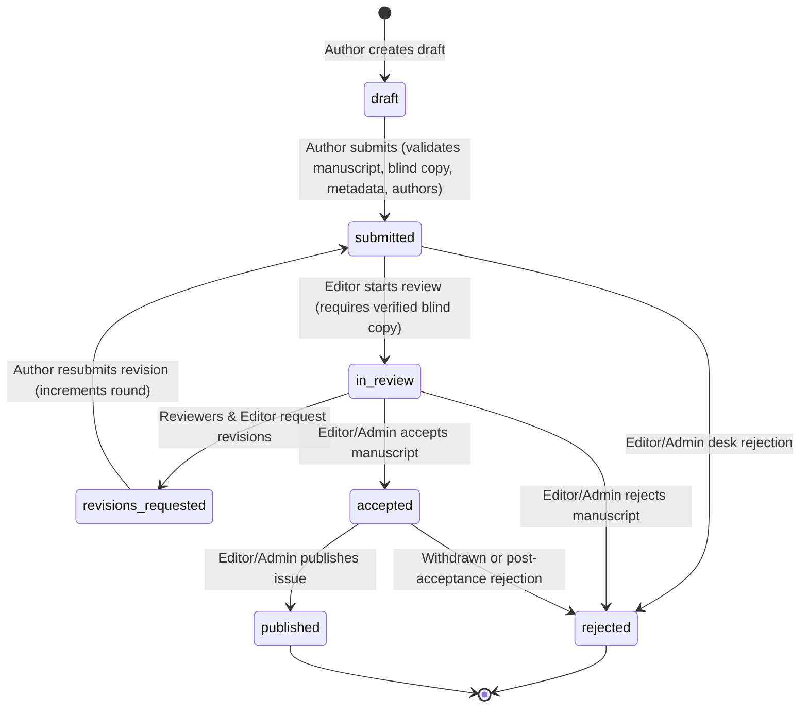
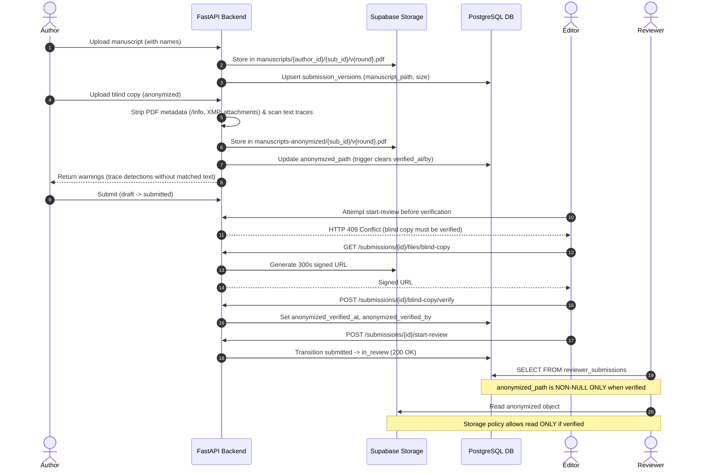

# Journal Platform Workflow & Submission Lifecycle

This document specifies the academic publishing submission lifecycle, round management, blind-copy review flow, authorization matrix, error mappings, file handling, and conflict-of-interest protections for **Stage 1A**.

---

## 1. Submission State Machine

The database enforces a strict, trigger-guarded state machine on `public.submissions.status` via `private.guard_submission_status_transition()`.



### Transition Authority Rules
- **Author**: May only transition `draft -> submitted` and `revisions_requested -> submitted`.
- **Editor / Admin**: May transition `submitted -> in_review | rejected`, `in_review -> revisions_requested | accepted | rejected`, `accepted -> published | rejected`.
- **System / Service Role**: Allowed any valid transition when `auth.uid() IS NULL`.

---

## 2. Round Logic

1. **Round Determination (`target_round`)**:
   - `target_round = current_round` when status is:
     - `draft`
     - `submitted` with the current round version not yet verified
   - `target_round = current_round + 1` when status is:
     - `revisions_requested`
2. **Immutable `current_round` in API**:
   - The API **never writes `current_round` directly**.
   - The PostgreSQL database trigger `private.guard_submission_status_transition()` automatically increments `current_round = current_round + 1` when status transitions `revisions_requested -> submitted`.
3. **Revisions Response**:
   - Submissions in `revisions_requested` require a non-empty `response_to_reviewers` body field on `POST /submissions/{id}/submit`, stored on the revision version row.

---

## 3. Blind-Copy Flow & Verification

To protect peer-review integrity and prevent unconscious bias, the platform implements a dual-manuscript workflow for every review round.



### Key Security Invariants
1. **Metadata Stripping**: The backend uses `pypdf` to rebuild the PDF page-by-page, stripping the `/Info` dictionary, XMP metadata streams, embedded attachments, and JavaScript actions.
2. **Author Trace Detection**: Case- and accent-insensitive text search detects author names and email addresses. Tokens under 4 characters are ignored. The response returns warning types and page numbers, **never returning matched text** to avoid leaking private identifiers.
3. **Database Guard Trigger**: `private.guard_submission_versions()` prevents non-editor/non-admin users from setting or altering `anonymized_path`, `anonymized_verified_at`, `anonymized_verified_by`, or `anonymized_review_note`. Changing `anonymized_path` automatically resets verification fields to `NULL`.
4. **Reviewer Isolation**: The `reviewer_submissions` SQL view and storage policies explicitly evaluate `anonymized_verified_at IS NOT NULL`. Reviewers can never observe or download an unverified blind copy.

---

## 4. Authorization & Endpoint Matrix

| Method | Path | Allowed Roles | Allowed Statuses | Ownership / Guard Rules |
|---|---|---|---|---|
| `POST` | `/submissions` | Any authenticated | Any | Creates draft with `author_id = caller.id` |
| `GET` | `/submissions` | Any authenticated | Any | Authors see own submissions; Editors/Admins see all |
| `GET` | `/submissions/{id}` | Any authenticated | Any | Owner, Editor, or Admin; returns 404 for unrelated users |
| `PUT` | `/submissions/{id}/metadata` | Owner, Editor, Admin | `draft`, `revisions_requested` | Normalized title, abstract, keywords |
| `PUT` | `/submissions/{id}/authors` | Owner, Editor, Admin | `draft`, `revisions_requested` | Max 50 authors; formatted affiliations |
| `POST` | `/submissions/{id}/manuscript` | Owner, Editor, Admin | `draft`, `revisions_requested` | Multipart PDF; max `MAX_UPLOAD_MB` |
| `POST` | `/submissions/{id}/blind-copy` | Owner, Editor, Admin | `draft`, `revisions_requested`, or unverified `submitted` | Metadata stripped, trace detection warnings |
| `POST` | `/submissions/{id}/submit` | Owner, Editor, Admin | `draft`, `revisions_requested` | Validates completeness; transitions via User client |
| `GET` | `/submissions/{id}/files/{kind}` | Owner, Editor, Admin | Any | Returns 300s signed URL; never exposes raw storage paths |
| `POST` | `/submissions/{id}/blind-copy/verify` | `editor`, `admin` | `submitted` | Requires uploaded blind copy; COI guard enforced |
| `POST` | `/submissions/{id}/blind-copy/reject` | `editor`, `admin` | `submitted` | Sets review note; leaves unverified; COI guard enforced |
| `POST` | `/submissions/{id}/start-review` | `editor`, `admin` | `submitted` | Requires verified blind copy; transitions to `in_review` |

---

## 5. Conflict of Interest (COI) Rule

To eliminate bias in editorial decision-making:
- Any endpoint under `/submissions/{id}/blind-copy/*` and `/submissions/{id}/start-review` requires that the caller is an `editor` or `admin`.
- If the editor/admin is also the author of the submission (`submission.author_id == caller.id`), the API immediately denies the operation with **`403 Forbidden`** and error message:
  ```
  "conflict of interest: editor cannot review or verify their own submission"
  ```
- Editors must recuse themselves from submissions they authored.

---

## 6. Storage & File Lifecycle

1. **Storage Buckets**:
   - `manuscripts`: Private bucket. Objects structured as `{author_id}/{submission_id}/v{round}.pdf`.
   - `manuscripts-anonymized`: Private bucket. Objects structured as `{submission_id}/v{round}.pdf`.
2. **Defense in Depth**:
   - Raw storage paths are never returned in public or author API responses.
   - Files are fetched exclusively using temporary signed URLs (`SIGNED_URL_SECONDS=300`) generated with the admin client.
   - Upload streams are consumed in 64 KB chunks, immediately aborting if payload size exceeds `MAX_UPLOAD_MB` (HTTP 413).
   - Filenames supplied by HTTP clients are discarded; server-side canonical paths are used exclusively.

---

## 7. Error Mapping Architecture

The FastAPI backend uses `app.clients.errors.map_postgrest_error()` to translate low-level PostgreSQL and PostgREST errors into clean, uniform client-facing HTTP exceptions:

| Postgres / PostgREST Error | HTTP Status | Code | Client Message |
|---|---|---|---|
| `42501` (insufficient_privilege) | **403** | `forbidden` | Action forbidden by security policy |
| `23514` (check_violation) / invalid transition | **409** | `conflict` | Invalid status transition or constraint violation |
| `23505` (unique_violation) | **409** | `conflict` | Resource or version already exists |
| `23503` (foreign_key_violation) | **422** | `validation_error` | Referenced entity not found |
| `22P02` (invalid_text_representation) / `23502` | **422** | `validation_error` | Invalid identifier or missing required value |
| Zero rows updated / selected | **404** | `not_found` | Resource not found |
| Upstream network / timeout / 5xx | **502** | `bad_gateway` | Upstream database service error |
